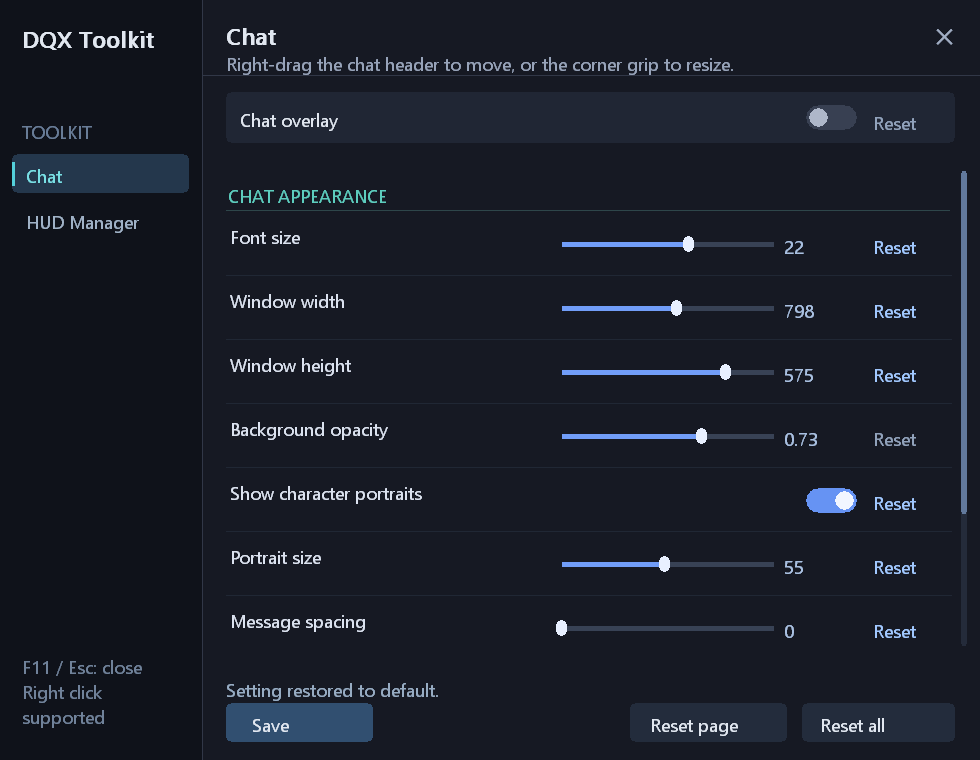
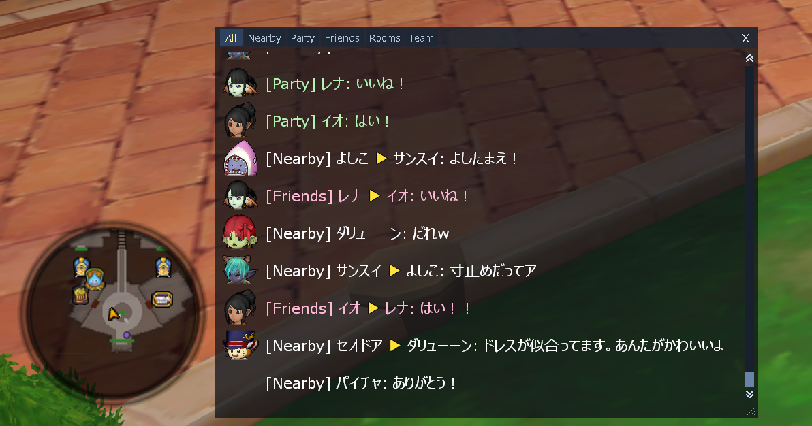

# Dragon Quest X - Questers Toolkit
This is a mod framework being designed to add in various features into DQX such as a chat window and other UI modifications along the way. This is very much early and will be an ongoing WIP.

# Installation
Download the ZIP file from the latest release and place `dqx-toolkit.ini` and `d3d9.dll` in your `SquareEnix\DRAGON QUEST X\Game` folder. To uninstall just remove both of these files from the Game folder.

Tested only on Windows 11, I have no plans to implement for other platforms at the moment.

# Usage
Press F11 to bring up the Questers Toolkit UI in-game and enable or adjust elements as you see fit. You can use right-clicks to select options and move the sliders. The chat window can be moved by holding right-click and dragging the top bar, the window can also be resized with the resize grabber in the bottom right corner.

# Disclaimer
This is a mod for an online game and as such, while it is unlikely, I cannot guarantee that by using this your account won't be suspended or banned. If you are okay with those risks don't make it obvious by streaming your game with these modifications on, don't talk about it using the in-game DQX chat.
 
 
 

